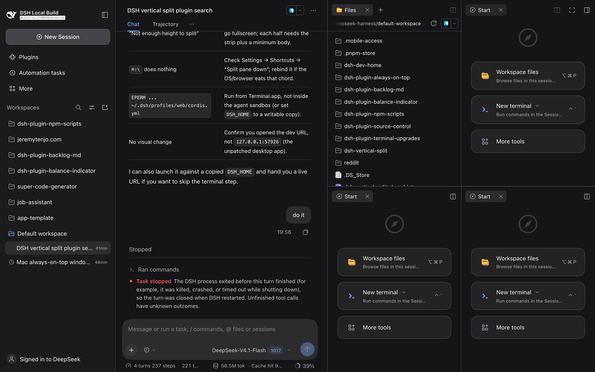
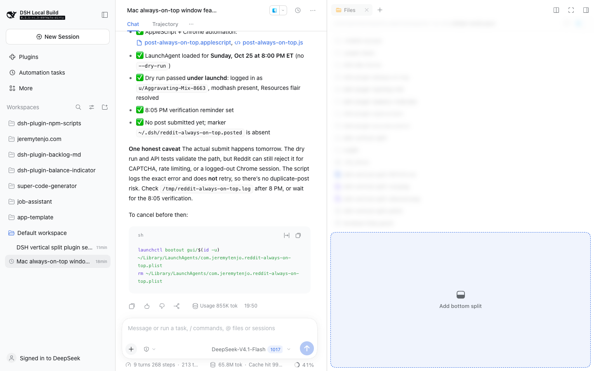
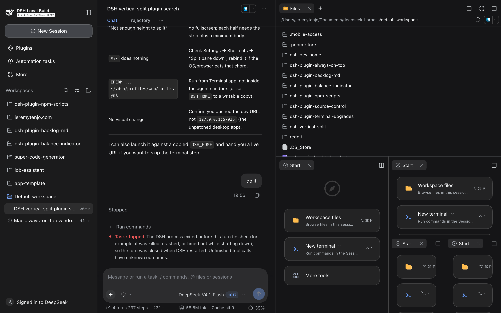
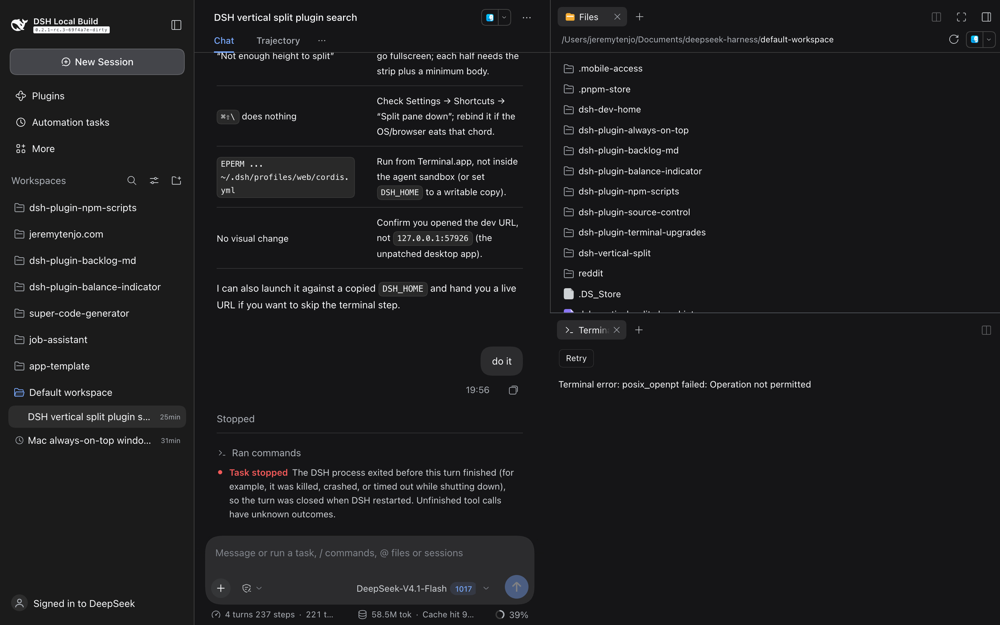

# dsh-plugin-infinite-split-tabs

Infinite split tabs for the **DeepSeek Harness** right sidebar: split down as well as right,
nest panes in both directions, drag tabs to any edge, and keep every layout across reloads.

> **Status: source patch, not yet a drop-in `dsh plugin add` package.**
> DSH links `ui-dockkit` into the Web shell statically, and `ui-sidebar-right` owns the dock.
> A third-party plugin cannot replace that split renderer at runtime, so this repository
> ships the working patch plus the test/build evidence. See [ROADMAP.md](ROADMAP.md) for the
> plugin conversion.



## Features

- **Split down** — `⌘⇧\` on macOS, `Ctrl+Shift+\` on Windows/Linux.
- **Split right** — the existing `⌘\` still works.
- **Nest both ways** — split any pane again, along either axis; there is no two-pane cap.
- **Drag to any edge** — left, right, top or bottom; the drop hint names the target.
- **Persistent layouts** — the nested split tree is saved per Session and restored.
- **Stable tab bodies** — tabs stay siblings in one flat CSS Grid, so terminals and file
  previews are not remounted by nesting.
- **One-line borders** — every pane on the panel's left edge draws its border, and stacked
  panes share a single 1px seam (no doubled divider line).

## Install (from source)

The patch is built against `deepseek-ai/deepseek-harness` at commit **`22ddee3`**
(the `0.2.1-rc.3` tree). Use a matching checkout; newer `master` may conflict.

```sh
git clone https://github.com/deepseek-ai/deepseek-harness.git
cd deepseek-harness
git checkout 22ddee3

git apply /path/to/dsh-plugin-infinite-split-tabs/patches/0001-right-sidebar-infinite-splits.patch

pnpm install
pnpm run dev:web
```

Open the printed URL, open a Session and the right sidebar, then click a tab and press
`⌘⇧\` / `Ctrl+Shift+\`.

For a desktop build:

```sh
pnpm run build
pnpm run package:desktop:dir
```

## Apply helper

```sh
./scripts/apply.sh /path/to/deepseek-harness
```

The script runs `git apply --check` first and refuses a dirty/conflicting tree.

## Test

```sh
pnpm exec vitest run packages/client/ui-dockkit/tests packages/client/ui-sidebar-right/tests
pnpm exec tsc -p packages/client/ui-sidebar-right/tsconfig.json --noEmit
pnpm exec tsc -b packages/client/ui-dockkit/tsconfig.json
```

At the recorded revision: **542 tests pass**, both packages typecheck, and a live headless
Chrome run built a five-pane nested tree, restored it after reload, and dragged a nested
divider.

## Screenshots

| Stacked + drop hint | Nested tree |
| --- | --- |
|  |  |

| Single-line seam | 2×2 |
| --- | --- |
|  |  |

## How it works

The patch touches three layers:

1. `ui-dockkit` — `TabLayout` flattens the split tree into one CSS Grid; each pane maps to
   the Grid tracks its rectangle covers, and each split gets a divider overlay sized to its
   own rectangle. `planSplitPane`/`DockController` take an axis. The docked-pane ceiling is
   removed (`MAX_DOCK_PANES = Infinity`).
2. `ui-sidebar-right` — the store/service accept nested splits and top/bottom drops; the
   `pane.splitDown` shortcut is registered; persistence validates arbitrary trees.
3. Borders — left-edge and seam classes replace the old first-column/column-only rules.

## Compatibility and caveats

- Built and tested against DSH **0.2.1-rc.3**.
- The split strip button still splits right; downward split is the shortcut/API.
- Edge drops use the dock kit's 25% edge bands (all four edges).
- There is no pane cap, so very deep trees can get cramped; the room rule still refuses a
  split when a pane cannot hold two working halves.
- Stock DSH rejects these nested layouts; downgrading clears that Session's stored layout.
- Upstream currently disables external pull requests; this repo is the distribution path.

## License

MIT. Portions are derived from DeepSeek Harness (MIT); see
[THIRD_PARTY_NOTICES.md](THIRD_PARTY_NOTICES.md).
